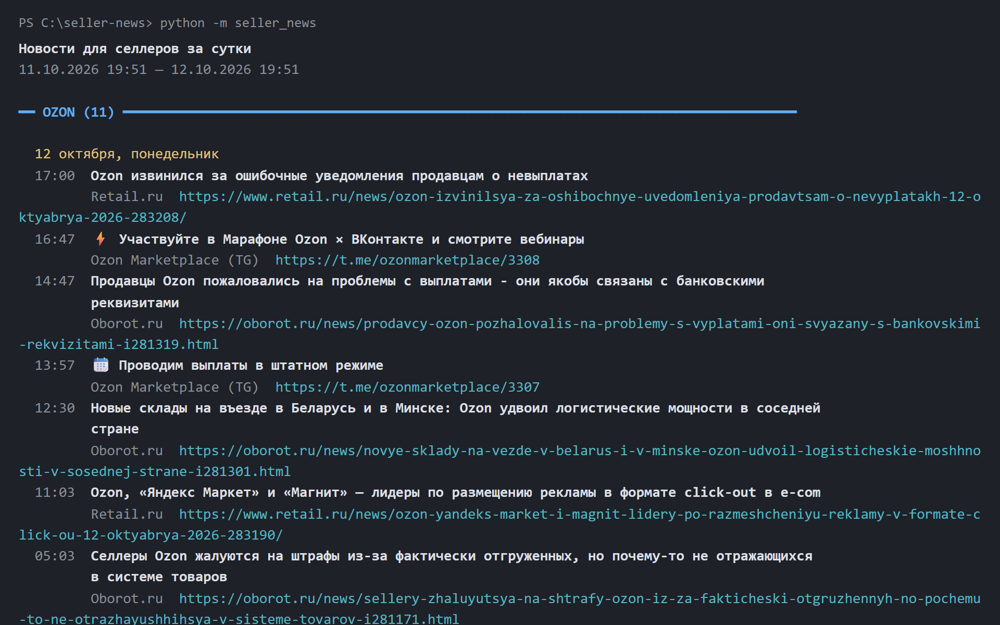
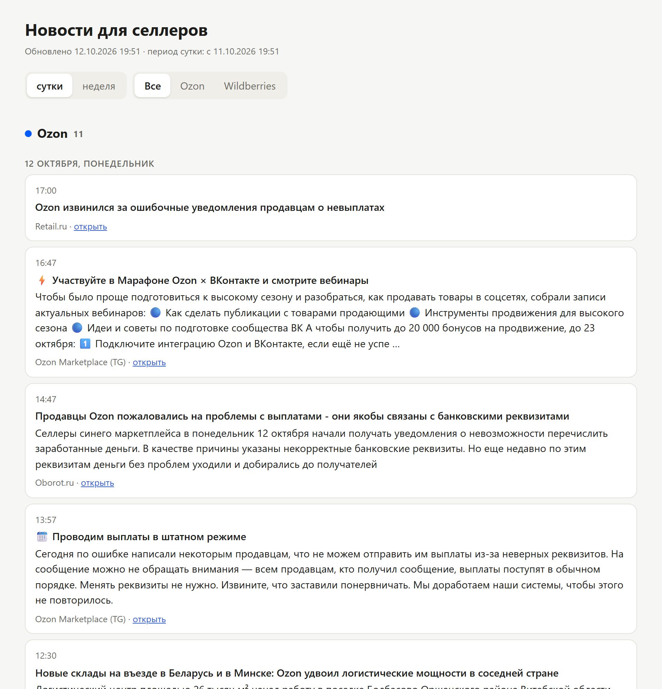
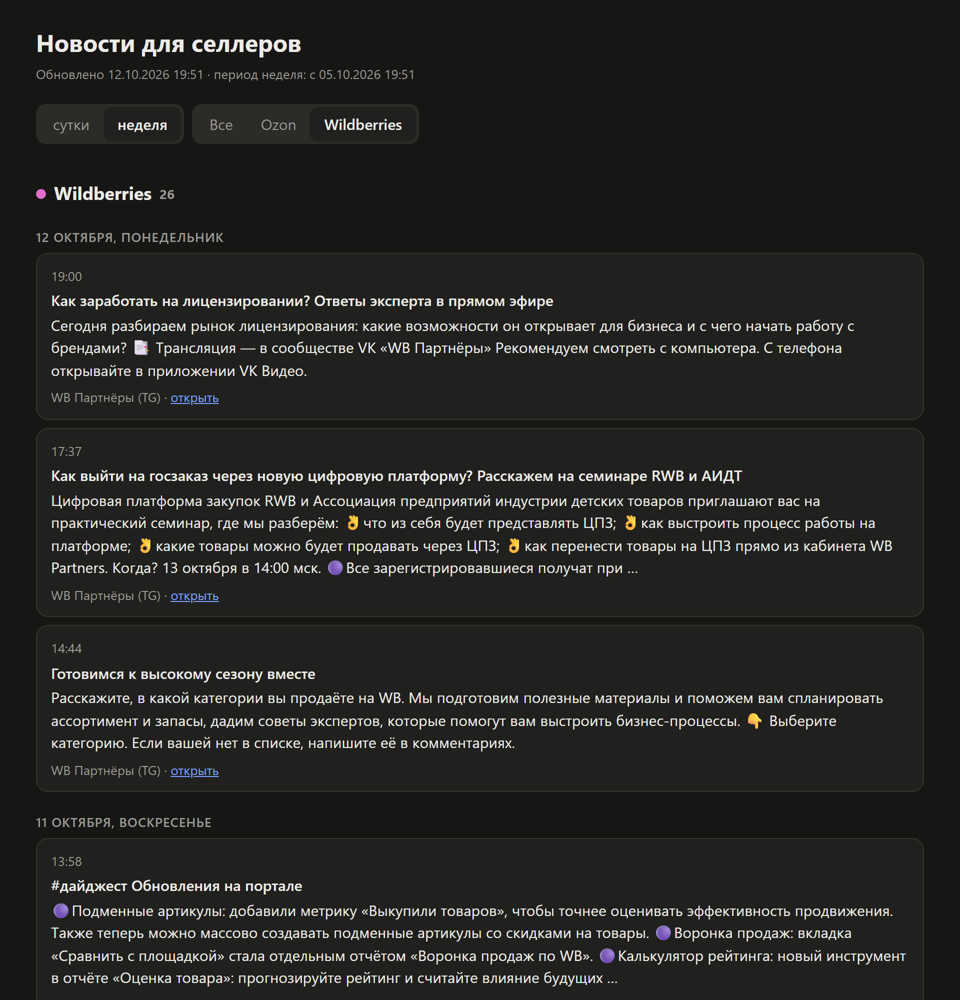
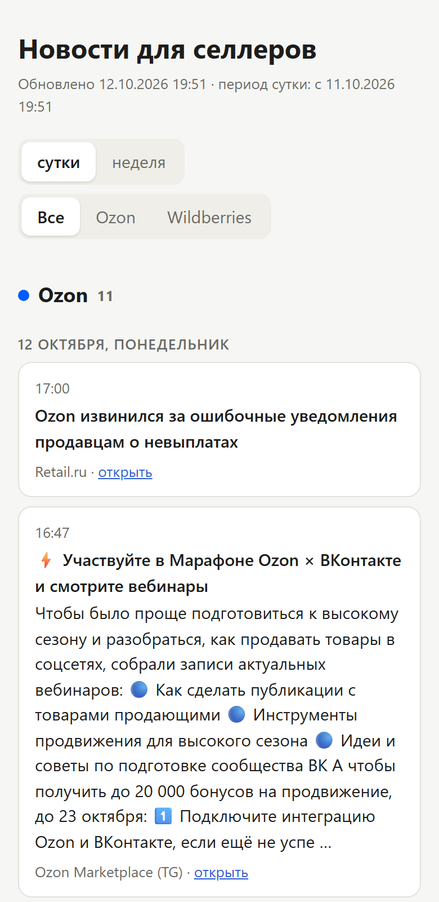

# Новости для селлеров Ozon и Wildberries

Собирает новости для продавцов из официальных Telegram-каналов и сайтов Ozon и Wildberries,
а также из отраслевых СМИ. Показывает их в консоли, сохраняет в файл или собирает HTML-страницу
с новостями дня и недели и обзором от нейросети.



## Установка

```
git clone https://github.com/Ykyki4/seller-news.git
cd seller-news
pip install -r requirements.txt
python -m playwright install chromium   # браузер для seller.ozon.ru и dev.wildberries.ru
```

## Примеры

### Новости в консоли

```
python -m seller_news                        # за последние 24 часа
python -m seller_news week                   # за 7 дней
python -m seller_news week -m wb --summary   # только WB, с текстом новостей
python -m seller_news --hours 6 -s ozon_tg   # 6 часов, один источник
python -m seller_news --list-sources         # список источников
```

Новости сгруппированы по маркетплейсу и дню. У каждой новости есть время, заголовок,
источник и ссылка:

```
Новости для селлеров за сутки
11.10.2026 18:57 — 12.10.2026 18:57

━━ OZON (11) ━━━━━━━━━━━━━━━━━━━━━━━━━━━━━━━━━━━━━━━━━━━━━━━━━━━━━━━━━━━━━━━━━━━━━━━━━━━━━━━━━━━━

  12 октября, понедельник
  17:00  Ozon извинился за ошибочные уведомления продавцам о невыплатах
         Retail.ru  https://www.retail.ru/news/ozon-izvinilsya-za-oshibochnye-uvedomleniya-...
  13:57  📆 Проводим выплаты в штатном режиме
         Ozon Marketplace (TG)  https://t.me/ozonmarketplace/3307
         FBO: открываем кросс-докинг в ПВЗ и ППЗ
         seller.ozon.ru  https://seller.ozon.ru/media/news/fbo-otkroem-kross-doking-v-pvz-i-ppz/

━━ WILDBERRIES (2) ━━━━━━━━━━━━━━━━━━━━━━━━━━━━━━━━━━━━━━━━━━━━━━━━━━━━━━━━━━━━━━━━━━━━━━━━━━━━━

  12 октября, понедельник
  17:37  Как выйти на госзаказ через новую цифровую платформу? Расскажем на семинаре RWB и АИДТ
         WB Партнёры (TG)  https://t.me/wbsellerofficial/6833
```

У новостей с seller.ozon.ru и dev.wildberries.ru есть только дата, поэтому время у них не выводится.

### Сохранение в файл

```
python -m seller_news week -o            # в news_<дата>_<время>.txt
python -m seller_news week -o news.txt   # в указанный файл
python -m seller_news -m ozon --summary -o ozon.txt
```

Текст печатается в консоль и одновременно сохраняется в файл в UTF-8 без цветовой разметки.

### HTML-страница с новостями дня и недели

```
python -m seller_news page            # собрать неделю, обработать нейросетью, открыть site/index.html
python -m seller_news page --no-ai    # то же без нейросети
python -m seller_news page -o D:/news.html --no-open
```

Страница — один HTML-файл, сервер не нужен. На ней есть вкладки «сутки» и «неделя», фильтры
по маркетплейсу, теме и «только важные». Поддерживается тёмная тема, на телефоне вёрстка
не ломается.

| Сутки, все маркетплейсы | Неделя, только WB, тёмная тема | Телефон |
|---|---|---|
|  |  |  |

На скриншотах страница собрана с `--no-ai`.

### Обработка нейросетью

Если задан ключ, нейросеть Claude (секция `[ai]` в `sources.toml`) делает для страницы:

- **выжимку** к каждой новости: 1–2 предложения о том, что изменилось и что делать продавцу;
- **тему** (тарифы, логистика, выплаты, API и т. д.) и **важность** от 1 до 3; новости с важностью 3
  помечаются «важно», по ним работает фильтр «только важные»;
- **склейку дублей**: если канал и сайт написали об одном и том же, на странице остаётся одна
  новость с пометкой «также: …»;
- **обзор главного** по каждому маркетплейсу отдельно за сутки и за неделю, со ссылками
  на новости, из которых он составлен.

Нужен ключ Anthropic API в переменной `ANTHROPIC_API_KEY`:

```
setx ANTHROPIC_API_KEY sk-ant-...
```

После этого терминал нужно перезапустить. api.anthropic.com из РФ не открывается, поэтому
запросы идут через системный прокси (`proxy` в `[ai]`, можно указать URL прокси). Если ключа
или доступа нет, страница всё равно строится, просто без обработки.

## Источники

| id | что | маркетплейс |
|---|---|---|
| `ozon_tg` | t.me/ozonmarketplace — официальный канал Ozon для продавцов | ozon |
| `wb_tg` | t.me/wbsellerofficial — «WB Партнёры», официальный | wb |
| `wb_api_tg` | t.me/wb_api_notifications — изменения WB API | wb |
| `ozon_site` | seller.ozon.ru/media/news — новости для продавцов на сайте Ozon | ozon |
| `wb_dev` | dev.wildberries.ru/release-notes — журнал изменений WB API | wb |
| `oborot` | RSS oborot.ru | по ключевым словам |
| `retail_ru` | RSS retail.ru | по ключевым словам |

Для источников с `marketplace = "auto"` маркетплейс определяется по ключевым словам из
`[marketplaces.*]` в `sources.toml`; новости, где не упомянут ни один маркетплейс, отбрасываются.

`ozon_site` и `wb_dev` закрыты JS-антиботом, поэтому открываются через Chromium (Playwright,
`seller_news/browser.py`). Каждый из них добавляет к сбору ~10 секунд. Куки антибота хранятся в
`.browser-profiles/`, эту папку можно удалить, она создастся заново. WB не пускает headless-браузер,
поэтому у `wb_dev` стоит `headless = false`: окно Chromium открывается за пределами экрана.
У новостей с этих сайтов есть только дата, поэтому время не показывается.

Новости из кабинета seller.wildberries.ru без входа недоступны, их можно получать только через
официальный API с токеном продавца.

## Как добавить сайт

- **Ещё один телеграм-канал или RSS-лента** — дописать блок `[[sources]]` в `sources.toml`.
- **Новый маркетплейс** (например, Яндекс Маркет) — блок `[marketplaces.ym]` с ключевыми словами;
  RSS-источники с `marketplace = "auto"` сразу начнут его находить.
- **Сайт нового типа** (HTML-страница, API) — файл в `seller_news/sources/`:

```python
from datetime import datetime
from ..http import get
from .base import Source, register

@register("mysite")            # type = "mysite" в sources.toml
class MySite(Source):
    def fetch(self, since: datetime):
        html = get(self.session, self.cfg["url"]).text
        # ... распарсить и вернуть [self.item(title, url, published_dt, summary), ...]
```

Модуль подхватывается автоматически. Любые поля из блока `[[sources]]` доступны через `self.cfg`.
Если один источник упал, остальные всё равно выводятся, а ошибка печатается внизу.

## Прокси

Параметр `proxy` у источника: `"direct"` (мимо прокси), `"system"` (системный прокси /
`HTTPS_PROXY`) или URL. Российские сайты рвут TLS при заходе через зарубежный прокси,
поэтому у них стоит `direct`. t.me из РФ без прокси может не открываться, поэтому у него `system`.
